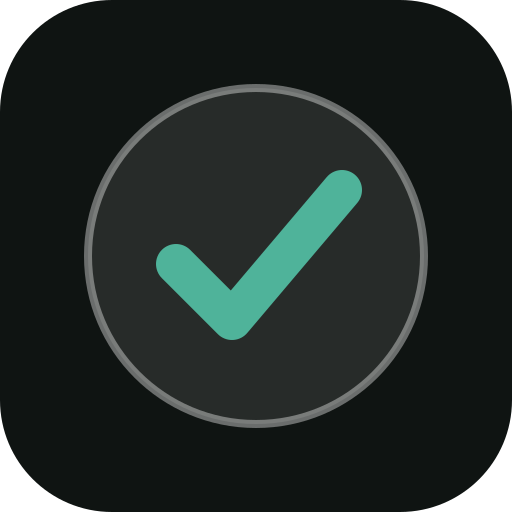
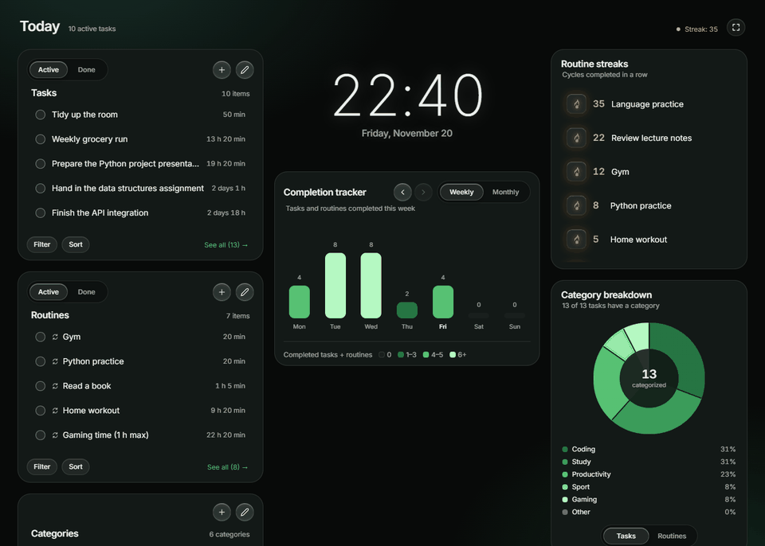
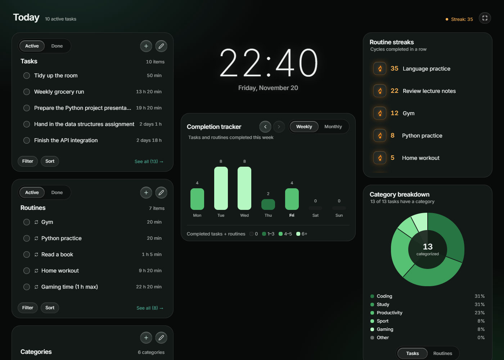
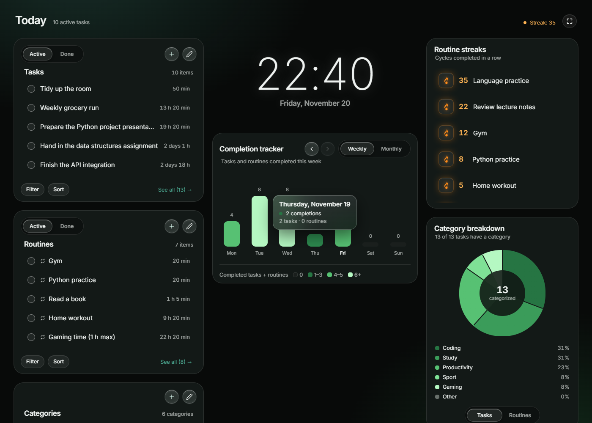
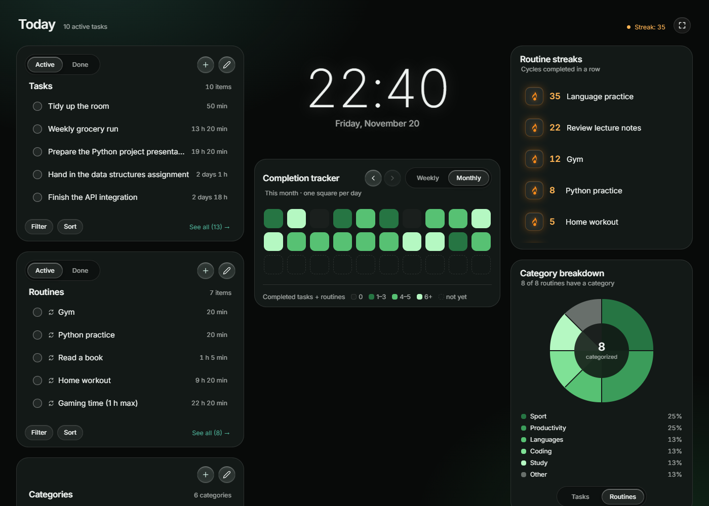
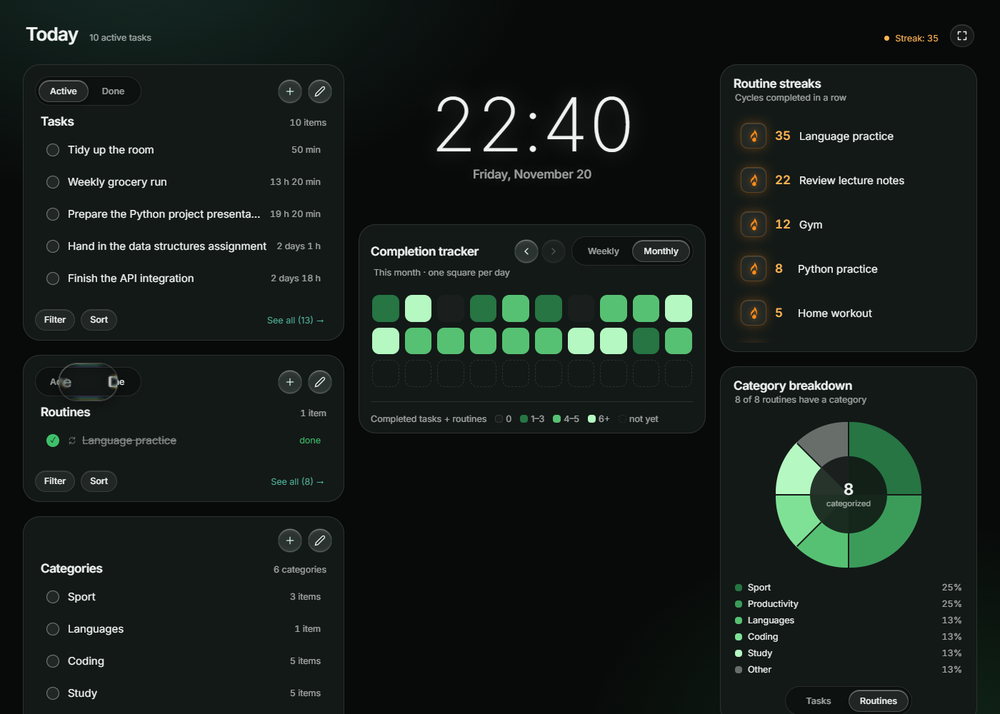
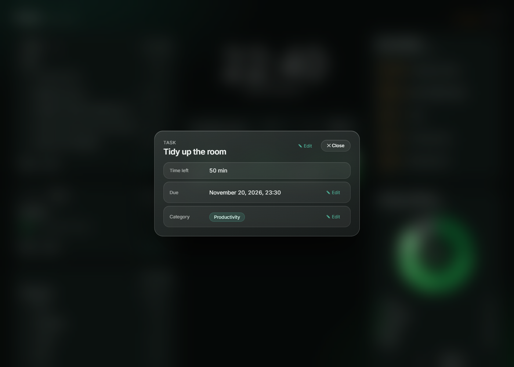

<p align="center">
  
</p>

# To-Do List

A small desktop app for tracking tasks, routines, streaks and categories, with statistics charts. The UI is plain HTML/CSS/JavaScript
shown in a native window with [pywebview](https://pywebview.flowrl.com/); the logic and storage are Python.
Your data stays on your machine as JSON files.

<p align="center">
  
</p>

| | |
|---|---|
|  |  |
|  |  |

<p align="center">
  
</p>

*Screenshots show the English UI with the built-in sample data (`python gui/app.py --demo`).*

## Features

- **Tasks** with a due date and time, optional category, and a time-left indicator.
- **Routines** with a frequency (every N days or chosen weekdays) and **streak** tracking.
- **Categories** you can add and delete; filter and sort by time left, name, category or streak.
- **Statistics**: weekly and monthly completion charts and a per-category donut chart.
- **Liquid glass UI**: translucent, blurred surfaces and a draggable selection bubble on the tab bars.
  Reduced-motion, reduced-transparency and high-contrast preferences are respected (see `gui/web/style.css`).
- **Languages**: English and Turkish.
- Starts fullscreen; press F11 or use the button at the top right to switch to a window.

## Requirements

- Python 3.9 or newer (the code uses nothing newer than Python 3.7 syntax; it is tested on 3.11 and 3.14).
- A WebView that pywebview can use. On Windows this is the Microsoft Edge WebView2 Runtime (preinstalled
  on current Windows 10/11). On macOS and Linux pywebview uses the system WebKit/Qt/GTK web view; see the
  [pywebview installation guide](https://pywebview.flowrl.com/guide/installation.html) for the extra
  system packages Linux needs.

## Installation

```bash
git clone https://github.com/copefe/todo-list.git
cd todo-list
python -m venv .venv
.venv\Scripts\activate          # Windows;  macOS/Linux: source .venv/bin/activate
pip install -r requirements.txt
```

## Running

```bash
python gui/app.py            # your real data (see "Where your data is stored")
python gui/app.py --demo     # sample data in a temporary folder, deleted on exit; never touches real data
```

`TODO_DEMO=1` is the same as `--demo`.

### Language

The UI language is chosen automatically: Turkish if the web view's language (on Windows, the display
language) starts with `tr`, otherwise English. To force one for a run, set `TODO_LANG` to `en` or `tr`:

```bash
TODO_LANG=tr python gui/app.py --demo            # macOS/Linux
$env:TODO_LANG = "tr"; python gui/app.py --demo  # Windows PowerShell
```

Translations live in `gui/web/locales/en.json` and `gui/web/locales/tr.json` (flat key → text).
To add a language, add a `<lang>.json` with the same keys and register it in `gui/web/i18n.js` and
`gui/i18n.py`; `tests/test_i18n.py` checks that the locale files stay in sync.

## Where your data is stored

| System  | Folder |
|---------|--------|
| Windows | `%APPDATA%\ToDoList` |
| macOS   | `~/Library/Application Support/ToDoList` |
| Linux   | `$XDG_DATA_HOME/ToDoList`, or `~/.local/share/ToDoList` |

The folder holds `items.json` (tasks and routines), `categories.json` (categories) and
`completion_history.json` (completion history). Each file is a JSON object with a `schema_version`
(currently `2`) and a list (`items`, `categories` or `completions`). Set `TODO_DATA_DIR` to use a
different folder. Back up the data folder by copying it.

Field names in `items.json`: `id`, `title`, `done`, `year`, `month`, `day`, `hour`, `minute` (local due
date and time), `routine` (true for routines), `category` (`""` = none), and for routines `frequency`
(every N days), `streak` and optionally `weekdays` (0 = Monday … 6 = Sunday). A completion record is
`{"date": "YYYY-MM-DD", "type": "routine" | "task"}`.

#### Upgrading from an older version

Older versions stored the same data under Turkish names (`gorevler.json`, `kategoriler.json`,
`tamamlama_gecmisi.json`, schema 1). On the first start of this version the app converts them **once**:

- the old files are only read; they are never changed, moved or deleted;
- new files with the new names are written next to them, read back and compared record by record;
  an existing new file is never overwritten;
- `.schema_v2_done.json` (file names, sizes, record counts and SHA-256, no task data) marks the
  conversion as done; details are appended to `migration.log`;
- if anything fails, the partly written files are renamed to `<name>.migration-failed-<time>`, the app
  shows a warning and keeps working with the old files exactly like the previous version, and the
  conversion is retried on the next start.

To run the conversion without starting the app, or to check a folder first:

```bash
python gui/migrate_data.py --check                    # report only (names, sizes, record counts, SHA-256)
python gui/migrate_data.py                            # convert the data folder (same as the first start)
python gui/migrate_data.py --data-dir <copy> --check  # any other folder, e.g. a copy of your data
```

Even older versions kept the data next to the program (repository root or the `.exe` folder). On first
start the app copies those files into the folder above (verified with SHA-256, nothing deleted or
overwritten) and then converts them as described. To go back to an older version, keep using its old
files: they are still there, unchanged (changes made in the new version are only in the new files).

## Running the tests

```bash
python -m unittest discover -s tests
```

These tests need no browser and do not touch your real data (they use a temporary data folder).

An additional browser check of the UI (not part of `unittest`) drives the real front end with
[Playwright](https://playwright.dev/python/) in headless Microsoft Edge:

```bash
pip install -r requirements-dev.txt
python tests/browser/run_check.py --lang en     # or --lang tr
```

It uses a temporary data folder and removes it afterwards. It also renders the UI from a schema-1 copy of
the same data (converted by the migration at start) and requires it to be identical; `--old <git ref>`
additionally compares with an older version. See the docstring of `tests/browser/run_check.py`.

## Building a Windows `.exe`

```bash
pip install -r requirements-dev.txt
cd gui
pyinstaller "To-Do List.spec"
```

The result is `gui/dist/To-Do List.exe` (a windowed app; the `web/` folder is bundled by the spec).
Build output goes to `gui/build/` and `gui/dist/`, which are git-ignored. The packaged app has not been
rebuilt and re-tested after the latest source changes; after building, start it once and check both languages.

## Known limitations

- Development and manual testing were done mainly on Windows. macOS and Linux have unit-test coverage for the data
  folder logic only; the UI there is untested.
- The glass effects (`backdrop-filter` blur and the SVG-filter magnifier on the selection bubble) were built and
  checked on Chromium-based engines (Edge WebView2 and headless Edge). Engines without `backdrop-filter` fall
  back to opaque surfaces, but other engines (WebKit on macOS/Linux) have not been tried.
- Fullscreen is the default start mode, and there is no in-app language switch (use `TODO_LANG`).
- This version still reads the old Turkish-named data files (schema 1) and converts them on first start;
  that compatibility code will be removed in a later version. After the conversion the old files are
  left in place and are no longer updated; an older version of the app started afterwards would show
  the data as it was at the time of the conversion.

## Contributing

Issues and pull requests are welcome. Please run `python -m unittest discover -s tests` before sending a
change, keep user-visible text in the locale files (not hard-coded), and do not commit personal data or
real task lists. Tests and examples should use made-up data.

## Third-party licenses

This project is licensed under the [MIT License](LICENSE). It includes or depends on:

| Component | Use | License |
|-----------|-----|---------|
| [Inter](https://github.com/rsms/inter) font (`gui/web/fonts/`, license text in `OFL-inter.txt`) | bundled UI font | SIL Open Font License 1.1 |
| [pywebview](https://github.com/r0x0r/pywebview) | native window / web view | BSD 3-Clause |
| [bottle](https://bottlepy.org/), proxy_tools | pywebview dependencies | MIT |
| [pythonnet](https://github.com/pythonnet/pythonnet), clr_loader | pywebview dependencies on Windows | MIT |
| cffi, pycparser | dependencies of clr_loader | MIT-0, BSD 3-Clause |
| typing_extensions | pywebview dependency | PSF-2.0 |
| [Playwright](https://playwright.dev/python/) | browser UI check (dev only) | Apache-2.0 |
| [PyInstaller](https://pyinstaller.org/) | building the `.exe` (dev only) | GPL-2.0-or-later with an exception that allows bundled programs under any license |

The Microsoft Edge WebView2 Runtime used on Windows is a separate Microsoft component and is not
distributed with this repository. Licenses were taken from each package's installed metadata; check them again
when you update the dependency versions.
